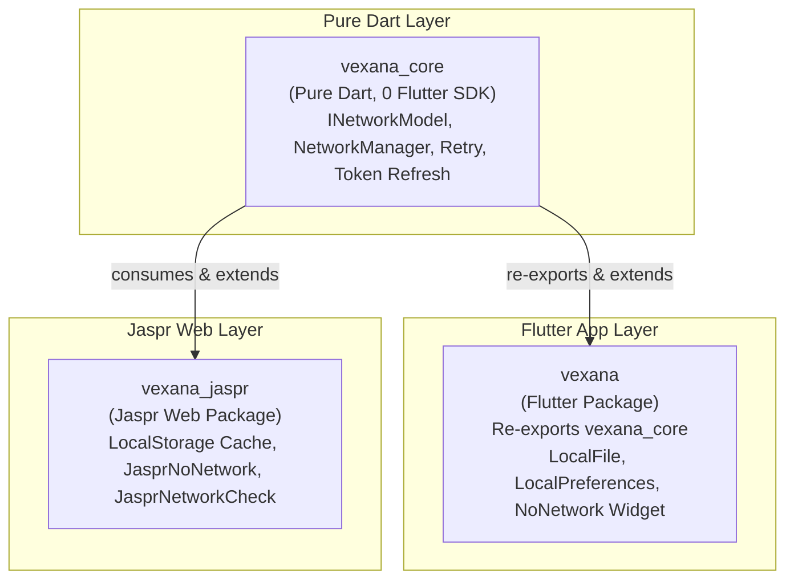

# Vexana Monorepo

<p align="center">
  <a href="https://deepwiki.com/VB10/vexana"></a>
  <a href="https://pub.dev/packages/vexana"></a>
  <a href="https://pub.dev/packages/vexana_core"></a>
  <a href="https://pub.dev/packages/vexana_jaspr"></a>
  <a href="https://github.com/VB10/vexana/actions/workflows/pr_check.yml"></a>
  <a href="https://opensource.org/licenses/MIT"></a>
  <a href="https://discord.gg/T6hGJhRN27"></a>
</p>

Vexana is an advanced, production-grade network layer built on top of [Dio](https://pub.dev/packages/dio). It offers type-safe dynamic model parsing, unified error modeling, automatic token refresh, retry interceptors, and multi-platform cache management.

Starting with **v6.1.0**, Vexana is organized as a modular monorepo divided into three specialized packages so your networking models and core logic can run anywhere — from Flutter mobile and desktop apps to pure Dart servers, CLIs, and Jaspr web applications.

---

## The Vexana Ecosystem



### Packages at a Glance

| Package | Version | SDK Requirement | Primary Use Case |
| :--- | :---: | :---: | :--- |
| [**`vexana_core`**](packages/vexana_core) | `^1.0.0` | Pure Dart (`^3.6.0`) | **Pure Dart core**: Zero `dart:ui` or Flutter SDK dependencies. Compiles with `dart2js`. Ideal for shared data models, Dart backends (Shelf/Frog), CLI tools, and core logic. |
| [**`vexana`**](packages/vexana) | `^6.1.0` | Flutter (`sdk: flutter`) | **Flutter applications**: Re-exports `vexana_core` with zero breaking changes. Adds `path_provider` disk cache, `shared_preferences` storage, and Flutter `NoNetwork` UI widgets. |
| [**`vexana_jaspr`**](packages/vexana_jaspr) | `^0.1.0` | Jaspr / Web (`^3.6.0`) | **Jaspr Web apps**: Browser `window.localStorage` cache adapter, reactive `JasprNoNetwork` banner component, and navigator connectivity checks. |

---

## Which Package Should I Choose?

| If you are building... | Use this package | Why? |
| :--- | :--- | :--- |
| **Flutter Mobile / Desktop App** | `vexana: ^6.1.0` | Gives you everything: core network manager + mobile file/shared preferences caching + Flutter dialogs/widgets. Zero migration needed. |
| **Shared Domain / Data Layer** | `vexana_core: ^1.0.0` | Define your `INetworkModel` classes in a pure Dart package shared across Flutter, Jaspr, and backend services without bringing in Flutter dependencies. |
| **Jaspr Web Application** | `vexana_jaspr: ^0.1.0` | Purpose-built for Jaspr with browser local storage caching and Jaspr components for offline state management. |
| **Dart Backend / Server (Shelf, Frog, Dart VM)** | `vexana_core: ^1.0.0` | Lightweight, pure Dart HTTP client with Dio, token refreshing, and retry capabilities. |

---

## Write Once, Use Everywhere: Shared Models

Define your model once in a pure Dart layer:

```dart
import 'package:vexana_core/vexana_core.dart';

final class User extends INetworkModel<User> {
  User({this.id, this.name, this.email});

  final int? id;
  final String? name;
  final String? email;

  @override
  User fromJson(Map<String, dynamic> json) => User(
        id: json['id'] as int?,
        name: json['name'] as String?,
        email: json['email'] as String?,
      );

  @override
  Map<String, dynamic>? toJson() => {'id': id, 'name': name, 'email': email};
}
```

Now use the exact same `User` class across:
1. **Flutter app** using `package:vexana/vexana.dart`
2. **Jaspr Web app** using `package:vexana_jaspr/vexana_jaspr.dart`
3. **Dart CLI / Server** using `package:vexana_core/vexana_core.dart`

---

## Repository Structure

```
vexana/
├── packages/
│   ├── vexana_core/       # Pure Dart networking core (models, manager, mixins)
│   ├── vexana/            # Flutter integration (cache, widgets, re-exports core)
│   │   └── example/       # Flutter example app (Wasm compatible)
│   └── vexana_jaspr/      # Jaspr Web integration (local storage, web components)
│       └── example/       # Jaspr sample web application
├── apps/
│   └── playground/        # Interactive live playground Flutter web app
├── tool/
│   └── verify_purity.dart # Transitive dependency analyzer (enforces pure Dart)
├── script/
│   ├── verify.sh          # Full verification suite (tests, purity, compile guard, builds)
│   └── push_version.sh    # Multi-package publishing tag helper
└── pubspec.yaml           # Workspace root & Melos task runner
```

---

## Development & Verification

This workspace uses Dart Pub Workspaces and Melos.

```bash
# Verify everything end-to-end (analyze, purity check, compile guard, all tests, web builds)
./script/verify.sh

# Fast verification (analyze + tests only, ~20s)
./script/verify.sh --quick

# Run all unit and integration tests across packages
melos run test

# Check vexana_core purity (ensures 0 flutter packages in transitive tree)
melos run purity

# Guard against dart:ui leakage into pure Dart code via JS compilation
melos run compile-guard
```

---

## Publishing to pub.dev

Automated publishing is powered by GitHub Actions and pub.dev OIDC.

- **Publish all 3 packages in topological order**:
  ```bash
  ./script/push_version.sh 6.1.0
  # Pushes tag: publish_6.1.0 -> triggers vexana_core -> vexana -> vexana_jaspr
  ```

- **Publish an individual package**:
  ```bash
  ./script/push_version.sh core 1.0.0     # Pushes vexana_core-v1.0.0
  ./script/push_version.sh vexana 6.1.0   # Pushes vexana-v6.1.0
  ./script/push_version.sh jaspr 0.1.0    # Pushes vexana_jaspr-v0.1.0
  ```

- **Manual Trigger**:
  Use the **Actions** tab in GitHub > **Publish to pub.dev** > **Run workflow** and select the package to publish (`all`, `vexana_core`, `vexana`, or `vexana_jaspr`).

---

## License

This project is licensed under the MIT License - see the [LICENSE](LICENSE) file for details.
